<div align="center">
    <h1><b>Docmost</b></h1>
    <p>
        Open-source collaborative wiki and documentation software.
        <br />
        <a href="https://docmost.com"><strong>Website</strong></a> | 
        <a href="https://docmost.com/docs"><strong>Documentation</strong></a> |
        <a href="https://twitter.com/DocmostHQ"><strong>Twitter / X</strong></a>
    </p>
</div>
<br />

## AI knowledge assistant (this fork)

This fork adds an AI assistant to Docmost that runs on a local model (Ollama, `qwen3:8b`) and a local embedding model. Nothing leaves the machine.

- **Permission-aware:** answers use only the pages the asking user may view. Missing and restricted content read the same.
- **Cited:** every answer lists its sources, and a source opens the page at the cited heading.
- **Extraction:** turns a contract PDF into structured fields, each with its quote and page.
- **Update agent:** finds outdated pages in a space and proposes changes. Nothing is written until the user reviews the diff and clicks "Übernehmen".

### How it works



ai-service never reads the wiki's tables. It gets page content and every permission decision through ai-bridge, so access is checked against live data, not the index. Extraction and the agent use the same bridge; the agent's tools act as the user. Details: [`docs/spec.md`](docs/spec.md) sections 5 and 7.

The seed data is a fictional German company, so the UI in the recordings is German. The badge at the bottom left names the signed-in user.

### Ask the wiki

Sabine (project lead) asks for the core working hours. The answer streams with a citation; clicking the source opens the page at that heading.


### Same question, different access

Lukas (working student) asks about the salary bands for department heads and gets the no-source answer. Jörg (managing director) asks the same question and gets an answer from the management space. 1.5× speed.


### Extract contract data

"Daten extrahieren" on a PDF attachment fills the contract schema; every value shows its quote and page. 2× speed.


### Update outdated pages

The agent searches the space, reads both travel-expense policies and proposes an update for the 2022 page. The page changes only after the user reviews the diff and applies it. 3× speed.


### Try it locally

Needs Docker, Node with corepack (pnpm), [uv](https://docs.astral.sh/uv/), `psql` and [Ollama](https://ollama.com) with `ollama pull qwen3:8b`.

```sh
docker compose -f docker-compose.dev.yml up -d
corepack enable && pnpm install --frozen-lockfile && pnpm build
(cd ai-service && uv sync)
scripts/run-demo.sh
```

`scripts/run-demo.sh` creates a throwaway database `docmost_demo`, seeds the fictional company, indexes it and serves the wiki on http://127.0.0.1:3104. It prints the four logins (password `seed-demo-password`). Ctrl-C stops it and drops the database. The first run downloads the embedding model (0.64 GB).

### Quality

- [Leak tests](reports/leak-tests.md): 111 questions across all seed users and scopes, 0 leaks.
- [Evals](reports/eval-local.md): citation accuracy, refusals, extraction and agent success with thresholds per model.
- Design and scope: [`docs/spec.md`](docs/spec.md). Operation: [`docs/runbook.md`](docs/runbook.md).

## Getting started

To get started with Docmost, please refer to our [documentation](https://docmost.com/docs) or try our [cloud version](https://docmost.com/pricing) .

## Features

- Real-time collaboration
- Diagrams (Draw.io, Excalidraw and Mermaid)
- Spaces
- Permissions management
- Groups
- Comments
- Page history
- Search
- File attachments
- Embeds (Airtable, Loom, Miro and more)
- Translations (10+ languages)

### Screenshots

<p align="center">


</p>

### License
Docmost core is licensed under the open-source AGPL 3.0 license.  
Enterprise features are available under an enterprise license (Enterprise Edition).  

All files in the following directories are licensed under the Docmost Enterprise license defined in `packages/ee/License`.
  - apps/server/src/ee
  - apps/client/src/ee
  - packages/ee

### Contributing

See the [development documentation](https://docmost.com/docs/self-hosting/development)

## Thanks
Special thanks to;


[Crowdin](https://crowdin.com/) for providing access to their localization platform.


[Algolia](https://www.algolia.com/) for providing full-text search to the docs.

